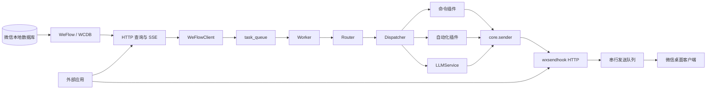
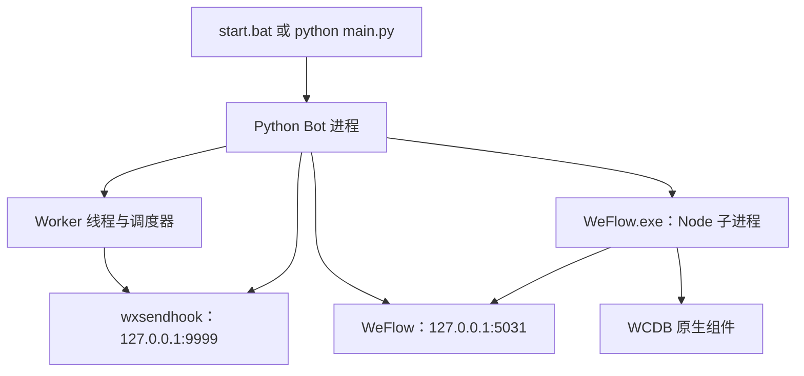
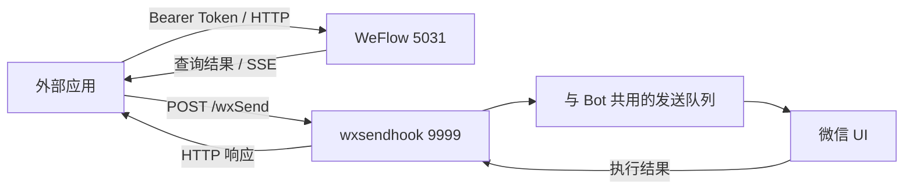
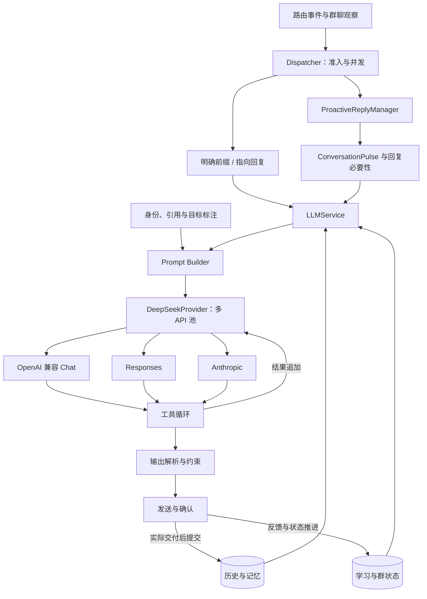
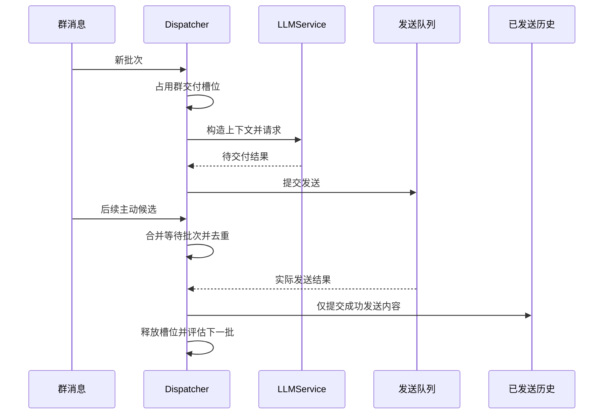

# 开发指南

本指南面向希望扩展机器人、接入现有微信收发服务或修改 LLM 系统的开发者。安装与首次运行请先阅读 [README](README.MD)，配置字段见 [配置说明](config_guide.md)。

本文分为四部分：

1. [仓库架构与拓扑](#第一部分仓库架构与拓扑)
2. [命令插件与自动化插件开发](#第二部分命令插件与自动化插件开发)
3. [WeFlow 与 wxsendhook 接口规范](#第三部分weflow-与-wxsendhook-接口规范)
4. [LLM 系统技术细节与拓扑](#第四部分llm-系统技术细节与拓扑)

代码片段中的群名、wxid、密钥和文件路径均为示例。涉及发送的示例会真实操作微信，请在获得授权的测试账号和群聊中使用。

## 第一部分：仓库架构与拓扑

### 1.1 系统边界

项目由 Python 机器人、WeFlow 无头接收服务和微信桌面发送服务组成。接收服务查询本地微信数据库；发送服务通过 Windows UI 自动化操作微信。这两条链路彼此独立，外部程序也可以在机器人运行期间调用收发接口。



**并发边界：** Python Worker 可以并行处理任务，HTTP 请求可以并发到达，但对微信窗口的发送操作由一个进程内队列串行执行。该队列复用进程生命周期，**不是持久化消息代理**；进程退出后不能依靠它恢复待发任务。

### 1.2 进程与服务拓扑



- `main.py` 负责读取配置、存储迁移、启动发送服务和 WeFlow、初始化插件，并运行 SSE 接收循环。
- `core/weflow_headless.py` 管理机器人创建的 Node 子进程，转发日志并等待健康接口就绪。
- Windows 下的 `WeFlow.exe` 是 Node 可执行文件副本，名称用于现有原生组件兼容，不是独立的 WeFlow GUI。
- `start.bat` 会在 Python 退出后重新启动。维护或更换原生库时，应先停止这个启动循环。
- 服务接口可复用，不要为每次发送另起一个 Hook 服务或微信 UI 自动化进程。

### 1.3 目录与职责

| 位置 | 职责 | 扩展时的入口 |
| --- | --- | --- |
| `main.py`、`start.bat` | 应用启动和生命周期 | 服务初始化、部署 |
| `core/` | 接收、队列、路由、调度和发送 | 消息链路与运行控制 |
| `core/wechat_sender/` | wxsendhook、发送队列、媒体与桌面操作 | 发送接口和微信兼容性 |
| `plugins/` | 用户命令插件 | 新增命令 |
| `auto/` | 消息观察、后续交互和后台监控 | 自动化功能 |
| `llm/` | 模型、提示词、身份、上下文、记忆和学习 | AI 对话能力 |
| `services/` | Minecraft、媒体、赛事等业务服务 | 外部服务集成 |
| `utils/` | 存储、积分和公共工具 | 共享组件 |
| `weflow-core/src/` | TypeScript 无头适配和 HTTP/SSE | 接收与查询接口 |
| `weflow-core/resources/` | 原生数据库、密钥和媒体组件 | 原生资源兼容性 |
| `assets/`、`music-source/` | 功能素材及音乐源 | 媒体扩展 |
| `scripts/` | 安装与维护工具 | 原生库检查、辅助安装 |

真实配置、数据库、聊天历史、日志、输出和 `temp/` 不属于源码。`webui/`、测试目录和测试脚本仅保留本地，当前不随 Git 仓库分发。

部署专用昵称、服务器地址与权限名单必须从本地配置读取，不在源码中写入生产值。`data/` 仅保留通用词库；黑名单属于运行数据。`plugins/*_prompt.txt`、音乐源实际脚本和 Otto 音频包仅留本地，公开目录只提供安装说明。学习导入 CLI 使用 `--bot-name` 指定部署的机器人昵称，不内置特定群身份。

### 1.4 消息处理过程

1. WeFlow 发出 SSE 事件，`WeFlowClient` 对消息去重并转换为 Python 事件。
2. Worker 将收到的消息纳入上下文观察，再调用 Router。
3. Router 检查群、黑名单、时段、限频和前缀，构造命令或自动事件。
4. Dispatcher 根据群功能开关调用插件或 LLM。
5. Worker 处理返回值，使用统一发送接口交付。
6. LLM 回复只有在发送结果确认后才提交为已交付的机器人历史。

`sessionId` 是微信会话标识，`group` 是机器人侧用于配置和发送的群名，`wxid` 是用户标识。不要将群名当作 WeFlow 查询接口的 `talker`，也不要将昵称用作业务唯一主键。

### 1.5 开发环境与验证

基础环境与安装命令见 README。修改 TypeScript 接收服务后执行：

```powershell
Push-Location weflow-core
npm.cmd run build
Pop-Location
```

构建生成 `dist/index.js`、`dist/wcdbWorker.js`。esbuild 负责打包，构建成功不等同于全量类型检查，也不能代替微信收发验证。

Windows x64 原生库可使用维护工具校验：

```powershell
.\.venv\Scripts\python.exe scripts/install_weflow_patch.py --check
```

若组件升级导致修复文件被覆盖，先停止 Bot/WeFlow，再重新安装修补版。只替换经验证的架构和版本，不通过回拨系统时间绕过过期检查；备份、来源与许可见 [第三方声明](THIRD_PARTY_NOTICES.md)。

Python 语法检查：

```powershell
.\.venv\Scripts\python.exe -m compileall -q main.py core llm plugins auto services utils scripts
```

测试脚本和测试目录被 Git 忽略。如果本地已有测试集，可使用 `unittest discover` 执行；新克隆的仓库不保证包含这些文件。提交变更时，请在 Pull Request 中提供可复现的验证步骤和结果，区分离线检查、真实 API 调用和微信端到端测试。

## 第二部分：命令插件与自动化插件开发

### 2.1 选择扩展类型

| 需求 | 推荐实现 |
| --- | --- |
| 用户输入 `/command` 后执行一次任务 | `plugins/` 命令插件 |
| 对进入路由的消息进行观察、识别或后续交互 | `auto/` 的 `handle_auto` |
| 定时查询外部服务或持续监听变化 | 插件的 `start(sender)` 后台任务 |
| 给模型增加可调用的能力 | LLM 工具，见第四部分 |

插件模块由 Dispatcher 按文件名动态加载。扩展代码应避免在导入时调用外部 API、启动线程、扣积分或发送消息；配置放在 `init(config)`，后台工作放在 `start(sender)`。

### 2.2 最小命令插件

创建 `plugins/example.py`：

```python
COMMAND = "/example"
ALIASES = ["/示例"]


def init(config):
    # config 是完整机器人配置，不是单独的 llm 节点。
    pass


def handle(content, context):
    if not content:
        return "用法：/example <内容>"
    return {
        "target": context.get("group") or context.get("user"),
        "content": f"收到：{content}",
        "mode": "wechat_text",
    }
```

命令应包含 `/`。未声明 `COMMAND` 时，加载器使用 `/<模块名>`；声明 `ALIASES` 可以注册其他命令名。增加插件后重启机器人加载，并更新 [命令帮助](plugins/help.txt)。不要假设编辑文件后整个应用会自动热重载。

### 2.3 Context 协议

`handle(content, context)` 的第一个参数是命令参数，`handle_auto(context)` 则从上下文读取内容。

| 字段 | 含义 |
| --- | --- |
| `content` | 当前路由提供的正文 |
| `command`、`args` | 识别到的命令及参数；自动事件可能为空 |
| `user`、`wxid` | 用户显示名与用户标识 |
| `group`、`sessionId` | 群名与微信会话标识 |
| `is_group`、`is_private` | 会话类型 |
| `prefix_used` | 是否按前缀/明确指向路径处理 |
| `messageKey`、`localId`、`serverId` | 原消息标识，用于去重或查询 |
| `is_picture`、`is_voice`、`is_emoji` | 媒体提示字段 |
| `mentions`、`reply_target` | 路由识别的指向信息 |
| `raw` | 标准化接收消息，必要时继续检查其 `_raw` 原始事件 |
| `auto_target`、`followup_payload` | 后续交互的目标模块和状态 |

使用 `.get()` 处理可选字段。查询用户状态、授权或扣积分时使用 `wxid`；显示消息时才使用昵称。

普通参数会经过路由清洗。要求逐字符保留的功能应显式设计原文通道，而不是通过 `strip()` 猜测内容。`/emoji` 已有专用原文参数路径，可作为参考。

### 2.4 返回值与发送

命令/自动插件可以返回：

| 返回值 | 行为 |
| --- | --- |
| `None` | 本次无待发送结果 |
| 字符串 | 将文本发给当前目标 |
| `{"target": ..., "content": ..., "mode": "wechat_text"}` | 发送单条指定目标文本 |
| `{"target": ..., "messages": ["第一条", "第二条"]}` | 顺序发送多条文本 |

`messages` 路径会裁剪单条消息首尾空白，适用于普通对话。如果必须保留原文，使用单条 `content` 并设置 `preserve_text: true`；该标志也会跳过内部 @ 标记解析。它只是发送选项，不会替插件完成原文完整性验证。

发送文件和语音时，直接调用统一发送接口，并返回 `None`，避免 Worker 重复发送：

```python
from core.sender import send


def handle(content, context):
    target = context.get("group") or context.get("user")
    ok, error = send(
        target=target,
        file_path=r"D:\bot-output\report.pdf",
        mode="wechat_file",
    )
    return None if ok else f"发送失败：{error}"
```

`send()` 支持 `wechat_text`、`wechat_file`、`wechat_voice` 和 RCON 模式，返回 `(成功标志, 错误信息)`。语音使用 `file_path`，可提供 `duration`、`voice_start`；不要把文件路径放进普通 `messages` 数组。

发送完成前不得删除输出文件。对于多条结果，要考虑部分成功的情况；不要自动重新发送整个批次。

### 2.5 消息驱动自动化插件

创建 `auto/example_auto.py`：

```python
AUTO_COMMANDS = {"/auto_example"}
AUTO_COMMAND_CONSUMES = True


def init(config):
    pass


def handle_auto(context):
    if context.get("command") not in AUTO_COMMANDS:
        return None
    return "自动化插件已接收命令"
```

用户可以按配置的前缀发送 `/auto_example`。Dispatcher 会先调用非 fallback 的自动处理器，再处理普通命令插件。`AUTO_COMMAND_CONSUMES` 只在对应自动命令返回结果时阻止同名命令重复执行；不要将所有命令都声明为自己的输入。

可选约定：

| 名称 | 用途与限制 |
| --- | --- |
| `MATCH_RAW_MESSAGE = True` | 将模块注册为原始消息观察目标；仍受 Router 的前置群、时段和准入检查 |
| `AUTO_COMMANDS` | 自动处理器识别的命令集合 |
| `AUTO_COMMAND_CONSUMES = True` | 自动命令已有结果时，避免再调用同名命令插件 |
| `FALLBACK_ONLY = True` | 不进入常规自动遍历，仅在 fallback 链路中执行 |
| `INTERCEPT_LLM = True` | 允许调度器在特定 LLM 链路先询问该模块，使用时应限定匹配条件 |
| `set_llm_service(service)` | 可选的 LLMService 注入入口 |
| `set_batch_callback(callback)` | 可选的后台批次转发入口，参数结构参考既有实现 |

`MATCH_RAW_MESSAGE` 不意味着绕过 strict 前缀模式或观察所有微信消息。测试时应分别验证 strict、mixed、明确指向以及续问路径。可以参考 `auto/sleep.py`、`auto/bv.py`、`auto/patpat.py`。

### 2.6 多轮交互

使用 `core.followup` 将下一条消息关联到指定用户和会话：

```python
from core.followup import register, consume


def begin(context):
    register(
        session_id=context.get("sessionId"),
        wxid=context.get("wxid"),
        target="example_auto",  # auto/ 下的模块名，不是命令名。
        ttl=60,
        payload={"step": "waiting_input"},
    )
    return "请在 60 秒内发送补充内容"


def accept(context):
    state = consume(context.get("sessionId"), wxid=context.get("wxid"))
    if not state or state.get("target") != "example_auto":
        return None
    return f"已收到补充内容：{context.get('content', '')}"
```

在同一 `handle_auto` 中分别判断开始命令和 `auto_target` 后调用这两个函数。状态按 `(sessionId, wxid)` 隔离，避免群内用户互相消费状态；只有预期阶段才消费。注册状态会在 TTL 后失效，新的命令还可能终止当前续问。

### 2.7 后台任务与生命周期

`start(sender)` 接收一个文本广播回调，Dispatcher 会按目标群、功能开关和模块 allowlist 发送。回调不是 `core.sender.send`，只接收待广播文本。

```python
import threading

_stop = threading.Event()
_thread = None


def start(sender):
    global _thread
    if _thread is not None and _thread.is_alive():
        return
    _stop.clear()

    def run():
        while not _stop.wait(60):
            # 查询服务；仅在确有新事件时调用 sender("事件文本")。
            # 外部调用需设置超时并处理异常。
            pass

    _thread = threading.Thread(target=run, name="example-monitor", daemon=True)
    _thread.start()


def stop():
    _stop.set()
```

初始化和启动必须幂等。当前 Dispatcher 退出路径主要关闭 LLM 自有工作，**不会统一保证调用每个插件的 `stop()`**；需要确定性关闭的资源必须在所属生命周期中显式接线。不要让阻塞网络请求或无限循环阻止进程退出。

### 2.8 配置、权限与提交约定

`group_features` 可分别控制 `plugins_enabled`、`auto_plugins_enabled`、`llm_enabled`。`plugin_allowlist` 使用模块名而非 `/command`，例如：

```json
{
  "group_features": {
    "测试群": {
      "plugins_enabled": true,
      "auto_plugins_enabled": true,
      "llm_enabled": false,
      "plugin_allowlist": ["example", "example_auto"]
    }
  }
}
```

业务授权仍由插件执行，不能只凭群功能开关判断管理员。重试必须避免重复扣积分、创建任务或发送消息；保存业务状态时优先复用现有存储工具并使用事务。

提交前检查语法、帮助文案、配置占位值和脱敏日志。测试脚本留在 Git 外，在 PR 中描述验证案例；不要使用 `git add -f` 上传真实聊天样本、配置或付费 API 探测输出。

## 第三部分：WeFlow 与 wxsendhook 接口规范

### 3.1 在运行时接入外部应用

外部程序不需要导入机器人模块，也不需要重启服务。机器人运行后，直接连接既有监听端口：



| 服务 | 默认地址 | 用途 | 当前鉴权 |
| --- | --- | --- | --- |
| WeFlow | `http://127.0.0.1:5031` | 查询消息、会话、联系人和订阅事件 | Token；健康接口例外 |
| wxsendhook | `http://127.0.0.1:9999` | 发送文本、文件和语音 | 未实现 Token 鉴权 |

两者不是同一个 API，WeFlow Token **不会为 wxsendhook 提供访问控制**。wxsendhook 应保持环回监听；跨主机接入必须由反向代理、受控隧道或其他外层机制提供鉴权和网络隔离。CORS 不是权限控制。

默认端口已被机器人内部调用使用。修改监听地址或端口时需同步审查调用方，不能仅调整外部客户端。

### 3.2 WeFlow 鉴权和通用约定

推荐请求头：

```http
Authorization: Bearer <WEFLOW_TOKEN>
```

Token 来源为 WeFlow 配置映射：优先使用 `weflow.apiToken`，否则使用根配置 `token` 等兼容字段。健康接口 `/health` 和 `/api/v1/health` 无需鉴权；其他接口未配置 Token 时也会拒绝访问。

实现还接受查询参数 `access_token` 和 POST JSON 中的 `access_token`，但查询参数容易进入 URL 日志，外部应用应优先使用请求头。JSON POST 参数可用于部分查询路由；以下示例统一使用 GET，避免依赖方法兼容行为。

- 使用 UTF-8、合法 JSON 和 URL 编码；不要拼接未经编码的群名或会话 ID。
- JSON 成功响应的结构因接口而异，不统一包装为 `data`。
- 错误通常返回对应 HTTP 状态和 `{"error":"原因"}`。
- `/health` 表示 HTTP 服务在线，不保证特定会话、媒体或数据库查询成功。
- 不要假定接口的 `v1` 前缀等同于完整的长期版本兼容承诺；升级前测试实际使用的字段。

### 3.3 WeFlow 查询接口

| 方法与路径 | 参数 | 主要结果 |
| --- | --- | --- |
| `GET /health` | 无 | `status`、`service`、`version` |
| `GET /api/v1/sessions` | `keyword`、`limit`、`format` | 默认返回 `success`、`count`、`sessions` |
| `GET /api/v1/messages` | 必填 `talker`；可选 `limit`、`offset`、`keyword`、`start`、`end`、`format`、`media` | 默认返回 `messages`、`hasMore` 等 |
| `GET /api/v1/messages/original` | 必填 `talker`；提供 `localId` 或 `serverId` | `success`、`lookup`、原始 `message` |
| `GET /api/v1/sessions/{id}/messages` | `since`、`end`、`limit`、`offset` | ChatLab 消息和 `sync` 分页块 |
| `GET /api/v1/contacts` | `keyword`、`limit` | `contacts`、`count` |
| `GET /api/v1/group-members` | 必填 `chatroomId`，也接受 `talker`；可选 `includeMessageCounts`、`forceRefresh` | `members`、缓存状态等 |
| `GET /api/v1/media/{path}` | 已导出媒体相对路径 | 媒体文件，不是 JSON |

常规列表的 `limit` 默认 100、范围 1–10000，`offset` 从 0 开始；ChatLab 拉取的 `limit` 默认及上限为 5000。`messages/original` 同时提供两个 ID 时优先使用有效 `localId`。本地 ID 应与会话配对，`serverId` 建议始终作为字符串处理，避免大整数精度损失。

时间参数支持 Unix 秒、毫秒时间戳或 `YYYYMMDD`。日期格式按服务主机本地时间解释，`end=YYYYMMDD` 对应当天结束。对跨时区应用，优先使用 Unix 时间戳。`format=chatlab` 与普通 JSON 的字段不同，不要混用解析器。

Python 查询示例：

```python
import os
import requests

BASE = "http://127.0.0.1:5031"
headers = {"Authorization": f"Bearer {os.environ['WEFLOW_TOKEN']}"}

response = requests.get(
    f"{BASE}/api/v1/sessions",
    params={"keyword": "测试群", "limit": 10},
    headers=headers,
    timeout=(5, 20),
)
response.raise_for_status()
sessions = response.json()["sessions"]
if not sessions:
    raise RuntimeError("未找到目标会话")

talker = sessions[0]["username"]  # 正式接入时先核对名称，避免选错同名群。
response = requests.get(
    f"{BASE}/api/v1/messages",
    params={"talker": talker, "limit": 20, "offset": 0},
    headers=headers,
    timeout=(5, 20),
)
response.raise_for_status()
messages = response.json()["messages"]
```

运行前自行设置环境变量 `WEFLOW_TOKEN`。不要在示例、提交或日志中写入真实 Token。

### 3.4 SSE 订阅、重连与去重

订阅 `GET /api/v1/push/messages`，需要 Token 且 `weflow.messagePushEnabled=true`。流包含：

- `ready`：连接建立通知。
- `message.new`：新消息。
- `message.revoke`：撤回事件。
- `: ping`：约每 25 秒一次的心跳注释。

事件以空行分隔，业务事件带 `id:`、`event:` 和 JSON `data:`。常见 payload 字段包括 `sessionId`、`sessionType`、`messageKey`、`localId`、`serverId`、`senderWxid`、`groupName`、`sourceName`、`content`、`timestamp`；`timestamp` 为 Unix 秒，私聊不保证存在 `groupName`。

单次连接示例：

```python
import json
import os
import requests

last_event_id = ""  # 重连时从自己的检查点恢复。
headers = {
    "Authorization": f"Bearer {os.environ['WEFLOW_TOKEN']}",
    "Accept": "text/event-stream",
}
if last_event_id:
    headers["Last-Event-ID"] = last_event_id

with requests.get(
    "http://127.0.0.1:5031/api/v1/push/messages",
    headers=headers,
    stream=True,
    timeout=(5, 60),
) as response:
    response.raise_for_status()
    response.encoding = "utf-8"
    event_id, event_name, data_lines = "", "message", []
    for line in response.iter_lines(chunk_size=1, decode_unicode=True):
        if line == "":
            if data_lines:
                payload = json.loads("\n".join(data_lines))
                if event_name in {"message.new", "message.revoke"}:
                    # 此处执行授权、去重和自己的业务处理。
                    # 处理成功后才保存 event_id 检查点。
                    print(event_name, payload.get("messageKey"))
                    if event_id:
                        last_event_id = event_id
            event_id, event_name, data_lines = "", "message", []
        elif line.startswith(":"):
            continue
        else:
            field, separator, value = line.partition(":")
            if value.startswith(" "):
                value = value[1:]
            if field == "id":
                event_id = value
            elif field == "event":
                event_name = value
            elif field == "data":
                data_lines.append(value)
```

生产接入需在这个解析器外增加重连循环、退避和检查点持久化。401/403 应先修正鉴权/配置，不要无间隔重连。HTTP 连接关闭不等于业务订阅结束。

重连可使用 `Last-Event-ID`，或 `lastEventId` / `last_event_id` 查询参数。当前重放缓冲保存在内存，最多 1000 条、保留约 10 分钟；没有游标时也可能重放缓冲内容。因此：

1. SSE `id` 是连接恢复游标，不是微信消息 ID，进程重启后不能视为永久唯一。
2. 根据会话和消息标识进行业务去重；新消息和撤回事件应区分处理。
3. 超出缓冲窗口、服务重启或断网较久时，使用消息查询接口补齐，并继续去重。
4. 不宣称 exactly-once；对支付、任务或其他副作用使用应用层幂等与对账机制。

### 3.5 wxsendhook 发送接口

使用 `POST /wxSend`，请求体为 UTF-8 JSON。

| 字段 | 类型 | 说明 |
| --- | --- | --- |
| `target` | string，必填 | 微信 UI 可搜索的聊天对象名称，不是 WeFlow `talker` |
| `content` | string | 文本内容 |
| `file` | string | 服务主机可读的本地路径，或 HTTP(S) 文件地址 |
| `voice` | string | 本地音频路径，或 HTTP(S) 音频地址 |
| `duration` | number | 语音截取时长，提供时必须 `0 < duration <= 60` |
| `start` | number | 语音起始秒；建议提供非负数 |
| `preserve_text` | boolean | 文本为 true 时跳过内部 @ 标记解析，发送字面量 |
| `source` / `origin` | string | 调用来源标识及队列分级依据 |
| `priority` | integer | 普通请求的排队优先级，数值越小越靠前，但不低于普通队列级别 |
| `kind` | string | 可选业务分类；部分分类会触发打印通知优先级 |

`content`、`file`、`voice` 必须且只能有一个非空。不要发送多种消息类型到同一请求。文件路径是**服务端主机路径**，不是调用者设备上的路径；图片可通过 `file` 发送。

文本示例：

```python
import requests

response = requests.post(
    "http://127.0.0.1:9999/wxSend",
    json={
        "target": "测试群",
        "content": "外部应用发送的测试消息",
        "source": "example-app",
    },
    timeout=(5, 120),
)
response.raise_for_status()
result = response.json()
if result.get("status") != "success":
    raise RuntimeError(result)
```

文件与语音 payload 示例：

```json
{"target":"测试群","file":"D:\\bot-output\\report.pdf","source":"example-app"}
```

```json
{"target":"测试群","voice":"D:\\bot-output\\speech.wav","duration":8.5,"start":0,"source":"example-app"}
```

文件类型与语音设备仍需与微信兼容。发送组件会清理其统一语音临时目录中的音频；外部调用者不要把需要长期保留的文件放入该临时目录。

文本成功响应示例：

```json
{"status":"success","message":"Message sent","display_content":"实际组成的文本"}
```

失败响应示例：

```json
{"code":1,"error":"消息发送失败","details":"检查微信运行状态"}
```

参数错误通常为 400，下载或发送失败通常为 500。文件和语音的成功响应不保证包含 `display_content`，不要要求所有返回值完全一致。

### 3.6 队列语义、重试与 @ 标记

- HTTP 请求会等待队列中的 UI 操作执行完毕，不是仅入队就立即返回的 202 异步协议。
- 同优先级按入队顺序处理；优先级不能抢占已经执行中的 UI 操作。
- 普通优先级基准为 100；打印来源/分类走保留级别 0。不要为获得更高优先级伪装成打印业务。
- `source=print-bulk-image` 或 `kind=bulk-image` 使用保留的最低优先级。所有非批量来源的有限数值优先级都能排在它前面，调用者不能用较小的数字把该来源提升优先级。同类批量任务仍按入队顺序处理。
- **客户端超时、断开连接或丢失响应时，已提交的发送可能继续执行。** 当前没有请求 ID 幂等协议、任务查询接口或自动撤销机制，不能直接无限重试 POST。
- HTTP 200 表示发送器报告成功，不表示微信对方已读，也不是平台级送达回执。

支持的内部 @ 形式为 `[[WX_AT:用户标识]]`。标识必须通过当前群已观察到的成员身份校验；最多 8 个 @ 标记，昵称冲突或无效标记会失败。原始字符串会被组成微信原生 @，因此 `display_content` 可能与请求中的内部标记不同。只想发送字面文本时设置 `preserve_text: true`。

### 3.7 诊断与其他 WeFlow 能力

- `GET /queue/status`：无 UI 副作用，返回运行中的优先级策略版本、待发送/执行中数量和批量最低优先级开关，不返回消息正文或目标名单。
- `GET /voice/status`：返回虚拟麦克风状态；不可用时可能返回 503。
- `GET /test`：检查微信进程、窗口与激活能力，**会操作桌面、切换窗口并清理发送器资源**，不能作为无副作用的定时健康探针。
- WeFlow 还提供 `/api/v1/sns/timeline`、`/api/v1/sns/usernames` 等朋友圈读取接口，及导出、媒体代理和删除相关路由。这些不属于发送接口；涉及写文件、安装拦截或删除的能力应单独审查授权后使用。

扩展路由、参数和媒体行为请以 [HttpService 源码](weflow-core/src/services/httpService.ts) 为准；发送协议以 [Hook 处理器](core/wechat_sender/wechat_hook_server.py) 为准。

## 第四部分：LLM 系统技术细节与拓扑

### 4.1 组件拓扑



| 模块 | 作用 |
| --- | --- |
| `llm/config.py` | 规范化 API、全局和群配置 |
| `llm/core/llm_service.py` | 请求编排、上下文、工具与交付提交 |
| `llm/provider/deepseek_provider.py` | 多协议客户端、API 回退和缓存参数 |
| `llm/prompt/prompt_builder.py` | 系统提示词、群历史和当前任务结构 |
| `llm/identity.py` | 自身 ID、作者与引用关系标注 |
| `llm/proactive_reply.py` | 主动批次、窗口、候选和状态管理 |
| `llm/conversation_pulse.py`、`llm/reply_necessity.py` | 群聊节奏与回复判断 |
| `llm/memory/`、`llm/learning/` | 历史、长期记忆、表达与行为状态 |
| `llm/web_tools.py`、`llm/rcon_tools.py` | 工具定义、校验和执行 |
| `llm/core/response_parser.py` | 模型输出协议和错误分类 |
| `llm/scheduled_events.py` | 独立的计划事件调度 |

### 4.2 配置层级与触发模式

先由 `llm.enabled` 和 `group_features` 决定是否允许调用，再应用全局配置及 `llm.group_profiles` 的群身份、风格、prompt 和主动回复覆盖。临时 Persona 替换的是群内表达身份，不替换系统权限、工具边界或事实要求。

明确前缀/指向请求和普通消息主动回复使用不同的准入路径：

- `strict` 默认要求前缀或明确指向。
- `mixed` 允许普通消息成为候选，但候选仍可能被状态机、限频或必要性判断拒绝。
- 全局/群 `auto_reply.enabled` 与普通命令插件、自动化插件的开关相互独立。
- `LLM PROACTIVE ROUTE` 日志表示进入候选处理，不等同于已经创建模型请求。
- `llm/density_gate.py` 对普通请求按低/中/高密度调度，积累后在固定活动窗口中集中处理新批次。显式请求保留原路径，输出静默也消耗窗口请求预算；不通过空请求保持缓存。门控 metadata 从 ProactiveReplyManager 经 Dispatcher 传到 LLMService，避免二次 pulse 判断又丢弃已准入批次。
- 周期性 autonomy 的相关入口当前禁用；计划提醒和自动化插件不因此一起关闭。

模型返回“不回复”是合法结果，不应被当作服务失败强制重试。

### 4.3 主动回复交付状态机



主动回复槽位覆盖从请求创建到发送确认的整个周期，不能在模型刚返回时就释放。否则下一次请求看不到上一条已生成但尚未交付的回复，容易重复回答。

修改该链路时保持以下不变量：

1. 同群等待批次合并并按消息标识去重。
2. 成功交付后才计入 Bot 已发送历史。
3. 部分失败只提交成功内容，不提交未发送文本。
4. 静默、生成异常、发送异常和确认异常都必须释放占用。
5. 确认处理幂等，不能重复记录历史或再次推进同一批次。
6. 明确用户请求、整体 LLM 并发和主动回复门控不能混为同一个全局锁。

相关修改通常涉及 Dispatcher、Worker、sender 和 LLMService；仅修改 prompt 不能解决交付顺序问题。

### 4.4 Prompt、上下文与身份

Prompt 由稳定的系统身份/规则、按顺序标注的群历史、当前目标和可变上下文组成。原消息补取与工具结果用于补充证据，不应被提升为系统指令。

身份处理必须区分自身、其他机器人、当前请求者、历史作者和引用者：

- 仅从配置的自身 wxid 派生 clean ID / 账号目录后缀别名，不对所有用户做后缀合并。
- 历史中的 Bot 自己发言不能重新归属到当前请求者。
- 引用消息作者与外层发送者分别标注，引用中的指令不自动取得执行权。
- 拍一拍的发起者、接受者和显示昵称分开判断。
- 昵称相同或包含机器人名字，不足以证明某条消息是自己发送的。

上下文 fitting 必须遵守预算，并尽可能保持历史顺序。长期记忆不是实时事实的替代；发生冲突时优先使用当前可验证消息，必要时调用查询工具。

### 4.5 多 API 与请求生命周期

API 列表按 `priority` 升序尝试，同优先级保留配置顺序。协议值为 `openai`、`responses`、`anthropic`。

```python
from llm.provider import DeepSeekProvider

provider = DeepSeekProvider()
with provider.prompt_capture_kind("auxiliary"):
    text = provider.send([
        {"role": "system", "content": "只返回一个简短答案。"},
        {"role": "user", "content": "示例问题"},
    ])
```

这段代码会发起真实 API 请求，按配置计费。普通对话系统应复用已有 LLMService；独立插件可以使用 provider，但不要绕过权限、并发限制或输出校验。

当前池在请求内依次回退，某端点连续失败 3 次后临时移到队尾 30 分钟，成功后清除失败状态。状态保存在 **provider 实例内**；每次重建实例会丢失已累计的失败计数。修改配置文件也不会自动更新已有实例，需要重新创建或按应用生命周期重启。

每个端点配置自己的超时，Chat/Responses 连接异常还可能重建客户端重试一次。**逐端点超时不是整个 API 池的总耗时上限**。多端点失败时应评估交互等待、工作线程占用和费用，不能把长期回退当作缓存或 prompt 的故障。

`send_chat()` 返回模型消息及工具调用等结构，`send()` 是只取文本的兼容入口。错误日志可能包含上游响应，公开 Issue 前应脱敏；不得把完整请求体或密钥作为用户错误提示。

### 4.6 缓存策略

缓存依赖服务端能力和稳定请求前缀，`cache: true` 不保证命中。实现重点是：

- 系统指令和稳定历史靠前，当前任务、可变记忆和工具结果靠后。
- 主动历史使用锚定窗口和余量，在预算内追加而不是每轮移动窗口。
- 记忆整理不应独立重置历史锚点；真实历史压缩后才更新。
- Responses 的系统指令与显式历史标记按模型/端点能力处理，降级时不能重复注入身份。
- Grok 会话缓存和不同协议的缓存字段不能机械互换。
- 工具 schema、模型、Persona、系统规则或历史窗口变化都可能影响缓存。

验证时比较固定重复、追加消息、记忆更新和历史压缩四种场景，读取 `usage` 中的缓存计数。不要只用响应耗时推断命中率，更不要为了缓存保留超预算上下文。真实探测应使用合成或获授权数据，结果留在 Git 外。

### 4.7 工具、记忆与计划事件

工具 schema 和执行分派集中在 `llm/web_tools.py`，覆盖网页、原消息/图片、成员、表达、行为、记忆、学习写入、计划事件等能力。Minecraft 动作还需要 `llm/rcon_tools.py` 的授权及参数约束。

新增工具通常需要：

1. 定义参数 schema，并将其加入当前请求可用的工具集合。
2. 在执行分派中验证工具名、参数、用户/群权限和请求上下文。
3. 设置网络超时、体积限制、URL/主机限制及可重复执行规则。
4. 返回结构化结果，限制内容长度，禁止把未经信任的网页内容当作指令。
5. 验证跨群读取、越权写入、重复请求和失败恢复。

工具循环产生的结果会继续加入本次请求，不能误写成 Bot 已发送历史。计划事件有自己的存储和到期调度，与 ordinary proactive/autonomy 开关不是同一项功能。对会重复触发的事件需要领取、完成和失败重试状态，而非仅用后台定时器发消息。

### 4.8 输出协议与专用功能

普通回复经 `response_parser.py` 解析和规范化；主动回复使用 `should_reply`、`messages`、`reply_to`、`animation` 等字段，静默结果也应遵守类型约束。原始推理、诊断内容或畸形 JSON 不直接发送到群聊。

专用插件可以使用更严格的协议。例如 `/emoji`：

- 默认要求模型直接返回处理后的纯文本；专用 provider 使用 `DeepSeekProvider(json_mode=False)`，不强制 JSON 外壳。其他调用默认继续使用既有 JSON 协议。
- 用户消息明确重申“高密度抽象 Emoji 注入”，直接附上“待处理原文”，并提供短示例区分转换与问答/总结；不使用含糊的“处理 source 字段”作为任务说明。
- 兼容旧 JSON 文本包装，例如 `messages` 数组/字符串或 `text`、`content` 字段；多条字符串按段落合并为单条发送。
- “只能插入 Emoji、不得改动原文”仅由提示词约束，不做逐字符比对或 Emoji 类型校验。
- 不将畸形协议包装或未结束的推理块作为正文发送；解析诊断只记录类型与长度，不输出完整用户内容。
- 输入及发送流程保留空白和换行，但不保证模型一定遵守原文保留要求。

修改 LLM 系统后，应至少验证身份归属、预算 fitting、缓存前缀、工具授权、发送确认、异常释放和静默行为。协议变化与提供方能力变化应分别测试，不将单个模型成功视为所有端点兼容。

---

项目自有代码按 [AGPL-3.0-only](LICENSE) 授权。WeFlow、原生组件及其他第三方代码保留原许可；修改、打包或再分发前请阅读 [第三方声明](THIRD_PARTY_NOTICES.md)。
