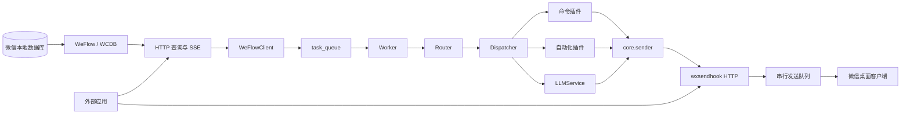
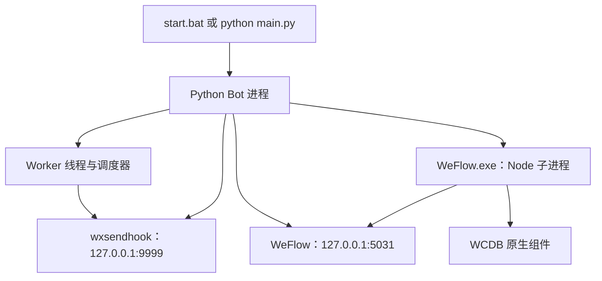
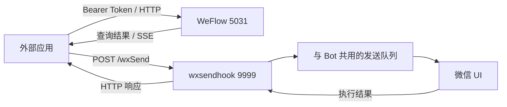
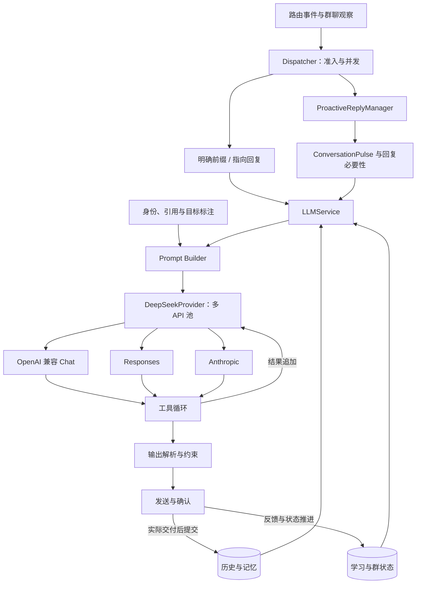
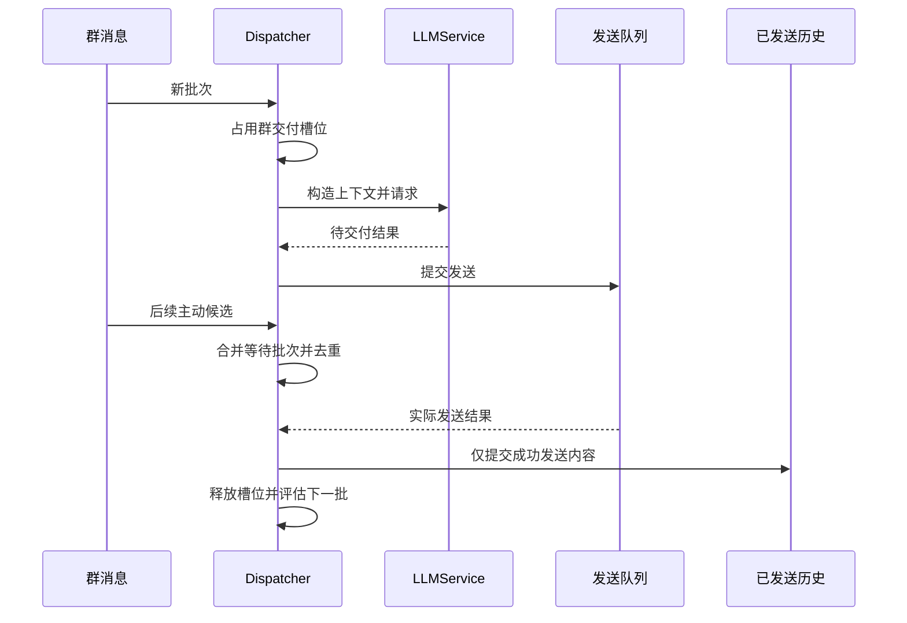

# 开发指南

本指南面向希望扩展机器人、接入现有微信收发服务或修改 LLM 系统的开发者。安装与首次运行请先阅读 [README](README.MD)，配置字段见 [配置说明](config_guide.md)。

本文分为四部分：

1. [仓库架构与拓扑](#第一部分仓库架构与拓扑)
2. [命令插件与自动化插件开发](#第二部分命令插件与自动化插件开发)
3. [WeFlow 与 wxsendhook 接口规范](#第三部分weflow-与-wxsendhook-接口规范)
4. [LLM 系统技术细节与拓扑](#第四部分llm-系统技术细节与拓扑)

代码片段中的群名、wxid、密钥和文件路径均为示例。涉及发送的示例会真实操作微信，请在获得授权的测试账号和群聊中使用。

## 第一部分：仓库架构与拓扑

### 1.1 系统边界

项目由 Python 机器人、WeFlow 无头接收服务和微信桌面发送服务组成。接收服务查询本地微信数据库；发送服务通过 Windows UI 自动化操作微信。这两条链路彼此独立，外部程序也可以在机器人运行期间调用收发接口。



**并发边界：** Python Worker 可以并行处理任务，HTTP 请求可以并发到达，但对微信窗口的发送操作由一个进程内队列串行执行。该队列复用进程生命周期，**不是持久化消息代理**；进程退出后不能依靠它恢复待发任务。

### 1.2 进程与服务拓扑



- `main.py` 负责读取配置、存储迁移、启动发送服务和 WeFlow、初始化插件，并运行 SSE 接收循环。
- `core/weflow_headless.py` 管理机器人创建的 Node 子进程，转发日志并等待健康接口就绪。
- Windows 下的 `WeFlow.exe` 是 Node 可执行文件副本，名称用于现有原生组件兼容，不是独立的 WeFlow GUI。
- `start.bat` 会在 Python 退出后重新启动。维护或更换原生库时，应先停止这个启动循环。
- 服务接口可复用，不要为每次发送另起一个 Hook 服务或微信 UI 自动化进程。

### 1.3 目录与职责

| 位置 | 职责 | 扩展时的入口 |
| --- | --- | --- |
| `main.py`、`start.bat` | 应用启动和生命周期 | 服务初始化、部署 |
| `core/` | 接收、队列、路由、调度和发送 | 消息链路与运行控制 |
| `core/wechat_sender/` | wxsendhook、发送队列、媒体与桌面操作 | 发送接口和微信兼容性 |
| `plugins/` | 用户命令插件 | 新增命令 |
| `auto/` | 消息观察、后续交互和后台监控 | 自动化功能 |
| `llm/` | 模型、提示词、身份、上下文、记忆和学习 | AI 对话能力 |
| `services/` | Minecraft、媒体、赛事等业务服务 | 外部服务集成 |
| `utils/` | 存储、积分和公共工具 | 共享组件 |
| `weflow-core/src/` | TypeScript 无头适配和 HTTP/SSE | 接收与查询接口 |
| `weflow-core/resources/` | 原生数据库、密钥和媒体组件 | 原生资源兼容性 |
| `assets/`、`music-source/` | 功能素材及音乐源 | 媒体扩展 |
| `scripts/` | 安装与维护工具 | 原生库检查、辅助安装 |

真实配置、数据库、聊天历史、日志、输出和 `temp/` 不属于源码。`webui/`、测试目录和测试脚本仅保留本地，当前不随 Git 仓库分发。

部署专用昵称、服务器地址与权限名单必须从本地配置读取，不在源码中写入生产值。`data/` 仅保留通用词库；黑名单属于运行数据。`plugins/*_prompt.txt`、音乐源实际脚本和 Otto 音频包仅留本地，公开目录只提供安装说明。学习导入 CLI 使用 `--bot-name` 指定部署的机器人昵称，不内置特定群身份。

### 1.4 消息处理过程

1. WeFlow 发出 SSE 事件，`WeFlowClient` 对消息去重并转换为 Python 事件。
2. Worker 将收到的消息纳入上下文观察，再调用 Router。
3. Router 检查群、黑名单、时段、限频和前缀，构造命令或自动事件。
4. Dispatcher 根据群功能开关调用插件或 LLM。
5. Worker 处理返回值，使用统一发送接口交付。
6. LLM 回复只有在发送结果确认后才提交为已交付的机器人历史。

`sessionId` 是微信会话标识，`group` 是机器人侧用于配置和发送的群名，`wxid` 是用户标识。不要将群名当作 WeFlow 查询接口的 `talker`，也不要将昵称用作业务唯一主键。

### 1.5 开发环境与验证

基础环境与安装命令见 README。修改 TypeScript 接收服务后执行：

```powershell
Push-Location weflow-core
npm.cmd run build
Pop-Location
```

构建生成 `dist/index.js`、`dist/wcdbWorker.js`。esbuild 负责打包，构建成功不等同于全量类型检查，也不能代替微信收发验证。

Windows x64 原生库可使用维护工具校验：

```powershell
.\.venv\Scripts\python.exe scripts/install_weflow_patch.py --check
```

若组件升级导致修复文件被覆盖，先停止 Bot/WeFlow，再重新安装修补版。只替换经验证的架构和版本，不通过回拨系统时间绕过过期检查；备份、来源与许可见 [第三方声明](THIRD_PARTY_NOTICES.md)。

Python 语法检查：

```powershell
.\.venv\Scripts\python.exe -m compileall -q main.py core llm plugins auto services utils scripts
```

测试脚本和测试目录被 Git 忽略。如果本地已有测试集，可使用 `unittest discover` 执行；新克隆的仓库不保证包含这些文件。提交变更时，请在 Pull Request 中提供可复现的验证步骤和结果，区分离线检查、真实 API 调用和微信端到端测试。

## 第二部分：命令插件与自动化插件开发

### 2.1 选择扩展类型

| 需求 | 推荐实现 |
| --- | --- |
| 用户输入 `/command` 后执行一次任务 | `plugins/` 命令插件 |
| 对进入路由的消息进行观察、识别或后续交互 | `auto/` 的 `handle_auto` |
| 定时查询外部服务或持续监听变化 | 插件的 `start(sender)` 后台任务 |
| 给模型增加可调用的能力 | LLM 工具，见第四部分 |

插件模块由 Dispatcher 按文件名动态加载。扩展代码应避免在导入时调用外部 API、启动线程、扣积分或发送消息；配置放在 `init(config)`，后台工作放在 `start(sender)`。

### 2.2 最小命令插件

创建 `plugins/example.py`：

```python
COMMAND = "/example"
ALIASES = ["/示例"]


def init(config):
    # config 是完整机器人配置，不是单独的 llm 节点。
    pass


def handle(content, context):
    if not content:
        return "用法：/example <内容>"
    return {
        "target": context.get("group") or context.get("user"),
        "content": f"收到：{content}",
        "mode": "wechat_text",
    }
```

命令应包含 `/`。未声明 `COMMAND` 时，加载器使用 `/<模块名>`；声明 `ALIASES` 可以注册其他命令名。增加插件后重启机器人加载，并更新 [命令帮助](plugins/help.txt)。不要假设编辑文件后整个应用会自动热重载。

### 2.3 Context 协议

`handle(content, context)` 的第一个参数是命令参数，`handle_auto(context)` 则从上下文读取内容。

| 字段 | 含义 |
| --- | --- |
| `content` | 当前路由提供的正文 |
| `command`、`args` | 识别到的命令及参数；自动事件可能为空 |
| `user`、`wxid` | 用户显示名与用户标识 |
| `group`、`sessionId` | 群名与微信会话标识 |
| `is_group`、`is_private` | 会话类型 |
| `prefix_used` | 是否按前缀/明确指向路径处理 |
| `messageKey`、`localId`、`serverId` | 原消息标识，用于去重或查询 |
| `is_picture`、`is_voice`、`is_emoji` | 媒体提示字段 |
| `mentions`、`reply_target` | 路由识别的指向信息 |
| `raw` | 标准化接收消息，必要时继续检查其 `_raw` 原始事件 |
| `auto_target`、`followup_payload` | 后续交互的目标模块和状态 |

使用 `.get()` 处理可选字段。查询用户状态、授权或扣积分时使用 `wxid`；显示消息时才使用昵称。

普通参数会经过路由清洗。要求逐字符保留的功能应显式设计原文通道，而不是通过 `strip()` 猜测内容。`/emoji` 已有专用原文参数路径，可作为参考。

### 2.4 返回值与发送

命令/自动插件可以返回：

| 返回值 | 行为 |
| --- | --- |
| `None` | 本次无待发送结果 |
| 字符串 | 将文本发给当前目标 |
| `{"target": ..., "content": ..., "mode": "wechat_text"}` | 发送单条指定目标文本 |
| `{"target": ..., "messages": ["第一条", "第二条"]}` | 顺序发送多条文本 |

`messages` 路径会裁剪单条消息首尾空白，适用于普通对话。如果必须保留原文，使用单条 `content` 并设置 `preserve_text: true`；该标志也会跳过内部 @ 标记解析。它只是发送选项，不会替插件完成原文完整性验证。

发送文件和语音时，直接调用统一发送接口，并返回 `None`，避免 Worker 重复发送：

```python
from core.sender import send


def handle(content, context):
    target = context.get("group") or context.get("user")
    ok, error = send(
        target=target,
        file_path=r"D:\bot-output\report.pdf",
        mode="wechat_file",
    )
    return None if ok else f"发送失败：{error}"
```

`send()` 支持 `wechat_text`、`wechat_file`、`wechat_voice` 和 RCON 模式，返回 `(成功标志, 错误信息)`。语音使用 `file_path`，可提供 `duration`、`voice_start`；不要把文件路径放进普通 `messages` 数组。

发送完成前不得删除输出文件。对于多条结果，要考虑部分成功的情况；不要自动重新发送整个批次。

### 2.5 消息驱动自动化插件

创建 `auto/example_auto.py`：

```python
AUTO_COMMANDS = {"/auto_example"}
AUTO_COMMAND_CONSUMES = True


def init(config):
    pass


def handle_auto(context):
    if context.get("command") not in AUTO_COMMANDS:
        return None
    return "自动化插件已接收命令"
```

用户可以按配置的前缀发送 `/auto_example`。Dispatcher 会先调用非 fallback 的自动处理器，再处理普通命令插件。`AUTO_COMMAND_CONSUMES` 只在对应自动命令返回结果时阻止同名命令重复执行；不要将所有命令都声明为自己的输入。

可选约定：

| 名称 | 用途与限制 |
| --- | --- |
| `MATCH_RAW_MESSAGE = True` | 将模块注册为原始消息观察目标；仍受 Router 的前置群、时段和准入检查 |
| `AUTO_COMMANDS` | 自动处理器识别的命令集合 |
| `AUTO_COMMAND_CONSUMES = True` | 自动命令已有结果时，避免再调用同名命令插件 |
| `FALLBACK_ONLY = True` | 不进入常规自动遍历，仅在 fallback 链路中执行 |
| `INTERCEPT_LLM = True` | 允许调度器在特定 LLM 链路先询问该模块，使用时应限定匹配条件 |
| `set_llm_service(service)` | 可选的 LLMService 注入入口 |
| `set_batch_callback(callback)` | 可选的后台批次转发入口，参数结构参考既有实现 |

`MATCH_RAW_MESSAGE` 不意味着绕过 strict 前缀模式或观察所有微信消息。测试时应分别验证 strict、mixed、明确指向以及续问路径。可以参考 `auto/sleep.py`、`auto/bv.py`、`auto/patpat.py`。

### 2.6 多轮交互

使用 `core.followup` 将下一条消息关联到指定用户和会话：

```python
from core.followup import register, consume


def begin(context):
    register(
        session_id=context.get("sessionId"),
        wxid=context.get("wxid"),
        target="example_auto",  # auto/ 下的模块名，不是命令名。
        ttl=60,
        payload={"step": "waiting_input"},
    )
    return "请在 60 秒内发送补充内容"


def accept(context):
    state = consume(context.get("sessionId"), wxid=context.get("wxid"))
    if not state or state.get("target") != "example_auto":
        return None
    return f"已收到补充内容：{context.get('content', '')}"
```

在同一 `handle_auto` 中分别判断开始命令和 `auto_target` 后调用这两个函数。状态按 `(sessionId, wxid)` 隔离，避免群内用户互相消费状态；只有预期阶段才消费。注册状态会在 TTL 后失效，新的命令还可能终止当前续问。

### 2.7 后台任务与生命周期

`start(sender)` 接收一个文本广播回调，Dispatcher 会按目标群、功能开关和模块 allowlist 发送。回调不是 `core.sender.send`，只接收待广播文本。

```python
import threading

_stop = threading.Event()
_thread = None


def start(sender):
    global _thread
    if _thread is not None and _thread.is_alive():
        return
    _stop.clear()

    def run():
        while not _stop.wait(60):
            # 查询服务；仅在确有新事件时调用 sender("事件文本")。
            # 外部调用需设置超时并处理异常。
            pass

    _thread = threading.Thread(target=run, name="example-monitor", daemon=True)
    _thread.start()


def stop():
    _stop.set()
```

初始化和启动必须幂等。当前 Dispatcher 退出路径主要关闭 LLM 自有工作，**不会统一保证调用每个插件的 `stop()`**；需要确定性关闭的资源必须在所属生命周期中显式接线。不要让阻塞网络请求或无限循环阻止进程退出。

### 2.8 配置、权限与提交约定

`group_features` 可分别控制 `plugins_enabled`、`auto_plugins_enabled`、`llm_enabled`。`plugin_allowlist` 使用模块名而非 `/command`，例如：

```json
{
  "group_features": {
    "测试群": {
      "plugins_enabled": true,
      "auto_plugins_enabled": true,
      "llm_enabled": false,
      "plugin_allowlist": ["example", "example_auto"]
    }
  }
}
```

业务授权仍由插件执行，不能只凭群功能开关判断管理员。重试必须避免重复扣积分、创建任务或发送消息；保存业务状态时优先复用现有存储工具并使用事务。

提交前检查语法、帮助文案、配置占位值和脱敏日志。测试脚本留在 Git 外，在 PR 中描述验证案例；不要使用 `git add -f` 上传真实聊天样本、配置或付费 API 探测输出。

### 2.9 将壳子插件配置接入 MaiBot WebUI

命令插件 `plugins/<name>.py`、自动化插件 `auto/<name>.py` 仍由 GSMPS Dispatcher 执行。WebUI 通过 `core/maibot_shell_registry.py` 登记管理条目，来源显示为 **GSMPS Wechatbot**；不要为显示配置而伪造 MaiBot 原生插件或迁移执行代码。对应 ID 分别为 `gsmps.command.<name>`、`gsmps.automation.<name>`，同名模块拥有独立开关。

在模块顶层声明 **字面量** `WEBUI_CONFIG`，例如：

```python
WEBUI_CONFIG = {
    'version': 1,
    'fields': {
        'reply_text': {
            'type': 'str', 'default': '拍你吗', 'max_length': 200,
            'label': '被拍一拍后的回复', 'reload': 'hot',
        },
        'timeout_seconds': {
            'type': 'float', 'default': 8, 'min': 1, 'max': 30,
            'label': '请求超时（秒）',
            'config_path': 'print_server.timeout_seconds', 'reload': 'restart',
        },
    },
}
```

登记器只用 AST 读取元数据，不导入或执行插件，因此声明不能使用函数调用、变量引用或字典展开。新增字段使用此格式；旧 `WEBUI_CONFIG_SCHEMA` 不作为 MaiBot WebUI 的数据源。所有展示字段必须有真实执行入口，禁止仅增加表单而不消费值。

- 类型：`bool`、`int`、`float`、`str`、`list`（字符串列表，`item_type='str'`）、`json`（对象或数组，表单以 JSON 文本编辑）。必须声明 `type`、`default`，建议提供 `label`、`description`。数字可声明 `min`、`max`、`choices`，文本可声明 `max_length`。后端严格校验类型、范围、选项和大小，拒绝未知字段、NaN 和无穷值。
- **即时读取**：不绑定原配置路径的字段，执行时调用 `core.shell_plugin_config.settings('gsmps.automation.patpat')['reply_text']`。显式使用 `reload='hot'`；保存后在下一次触发时生效，已运行的任务不被强行中断。
- **原配置绑定**：`config_path` 为原 `config.json` 的点分路径。WebUI 首次展示部署现值，覆盖值保存于本机 `config/gsmps_management.json`，不改写原配置。Dispatcher 初始化前调用 `apply_overrides()` 将已声明绑定合并进完整配置，再传给原模块 `init(config)`。依赖启动缓存的字段必须标 `reload='restart'`，由操作者手动重启，不能声称热更新。热更新的绑定字段必须在执行时使用 `settings()` 读取，例如彩票 `_settings()`。
- **共享配置**：相同 `config_path` 只存一份值，例如 `/theroom` 和锦标赛监控共用 `tournament.enabled`。不得为共享服务设置互相覆盖的模块私有副本。表单与源码中应说明共享关系。
- **敏感字段**：`secret=True` 使用密码控件；读取接口、原始 TOML 和 schema 默认值均只返回 `********`。保存这个占位符会保留原值，显式留空会清除。勿将密钥放进 agent 能力目录、日志或提交版本库。管理状态文件与备份已被 Git 忽略。
- **通用控制**：命令与自动化条目自动获得 `cooldown_seconds`、`allow_groups`、`allow_users`、`agent_enabled`。它们是额外限制，不替代原目标群、业务管理员权限或命令权限。后台任务的发送仍须经 Dispatcher 按目标群审核；不得绕过开关直接发送。后台广播传入 `_background=True`，执行群白名单和启停检查；没有请求用户，不应用用户白名单和用户冷却。限频只在处理有结果后登记，读取状态不能消耗冷却。
- **保存与重置**：配置表单和原始 TOML 共用同一个校验保存入口，一次原子写入；修改失败不写入任何字段。重置先备份管理状态，再移除覆盖并恢复部署原值；共享路径会同步恢复。涉及 `restart` 的字段会提示下次重启生效。

实际入口：`src/webui/services/gsmps_management.py` 生成原生表单 schema（含 `ui_type`），`src/webui/routers/plugin/config_routes.py` 复用现有配置路由。更新后端或前端代码后需要手动重启；前端修改需在 `dashboard/` 执行 `npm ci`、`npm run build`，本仓库 `.gsmps-managed` 标记使 WebUI 使用本地 `dashboard/dist`。

验收至少覆盖：字段可发现和渲染、保存后重新读取一致、执行消费新值、重启绑定合并、共享字段同步、错误类型/越界/未知字段拒绝且不部分落盘、敏感值不泄露、关闭和权限限制阻止触发。自动化测试使用临时实例目录和假发送端，不向真实群发送测试消息。运行 `python -X utf8 scripts/maibot_shell_config_acceptance.py`。

原生插件需要将复杂设置合入自身配置页时，可在 `get_webui_config_schema()` 返回值中声明 `embedded_webui_page: '<page_id>'`，指向该插件 `webui.json` 已注册的 custom 页面。主站复用原有沙箱、主题与 API 权限网关嵌入页面，并从独立导航中隐藏该页；不要改变严格校验的页面 `placement` 协议。普通字段仍走原生 schema 与保存按钮，标签导入、授权等动作必须明确提示即时保存。隐藏旧表单只筛选 schema 的 sections/layout，不删除运行时兼容字段或在保存时丢弃隐藏值。元数据由 Host 注册表生成，后端更新需用户手动重启。

### 2.10 双平台壳子插件的消息与发送约定

QQ 入站由 `core/shell_platform_bridge.py` 生成 Router 兼容结构，复用原 Dispatcher 执行插件；不复制插件为 MaiBot 原生插件。未被插件消费的消息只进入一次原生 LLM 核心。禁止将 QQ 消息送入微信 LLM 转译入口。

- 使用 `platform`、`account_id`、`scope`、`native_session_id` 保留来源，`user_id`、`group_id` 保存平台真实 ID；昵称、群名仅用于展示，不能作为跨平台身份或发送键。微信用户以 wxid 识别，QQ 的兼容 `wxid` 为 `qq:<user_id>`，不能继承同名微信用户的权限或积分。
- QQ 兼容目标键为 `qq:<account_id>:<scope>:group:<group_id>` 或 `qq:<account_id>:<scope>:private:<user_id>`，使用 `utils.platform_target` 构造和解析。会话状态、后续图片、队列去重和后台任务都要保存完整目标。不要把裸 QQ 群号交给旧微信发送接口。
- 插件沿用 `core.sender.send()` 的兼容模式，但必须在真实 `legacy_plugin_scope` 中调用。发送器依据可信来源选择出口：QQ 转为原生组件交给 SendService/Broker；微信保留现有出口。后台线程必须保留上下文，后台显式目标通过 `context_for_target()` 恢复上下文。原生事件循环内使用异步发送，不能调用同步包装器阻塞自己。
- QQ 不继承原微信 `group_features` 和群显示名白名单。准入由麦麦原生适配器策略控制，插件全局开关、原生会话命令禁用以及插件自己的业务授权继续生效。LLM 活跃度由原生聊天流设置控制；不要再增加一套壳子 QQ 群启用名单。
- 插件消息保留 `plugin_trigger` / `plugin_output` 来源标记，不能当作自由 LLM 决策回复。引用、聊天记录正文不能被当作当前命令输入；拍一拍/戳一戳只接受可信适配器通知，不能凭文本冒充系统事件。

验收使用临时实例、真实 Router/Dispatcher、原生发送及适配器编解码，仅截获最终外发；覆盖同名群隔离、改名后身份稳定、消息/媒体、连续交互、命令开关与普通 agent 权限。入口为 `scripts/maibot_dual_plugin_acceptance.py`。仅在 Router 中替换为记录处理器的全模块匹配矩阵，不代表每个插件的外部业务服务已实测可用。

## 第三部分：WeFlow 与 wxsendhook 接口规范

### 3.1 在运行时接入外部应用

外部程序不需要导入机器人模块，也不需要重启服务。机器人运行后，直接连接既有监听端口：



| 服务 | 默认地址 | 用途 | 当前鉴权 |
| --- | --- | --- | --- |
| WeFlow | `http://127.0.0.1:5031` | 查询消息、会话、联系人和订阅事件 | Token；健康接口例外 |
| wxsendhook | `http://127.0.0.1:9999` | 发送文本、文件和语音 | 未实现 Token 鉴权 |

两者不是同一个 API，WeFlow Token **不会为 wxsendhook 提供访问控制**。wxsendhook 应保持环回监听；跨主机接入必须由反向代理、受控隧道或其他外层机制提供鉴权和网络隔离。CORS 不是权限控制。

默认端口已被机器人内部调用使用。修改监听地址或端口时需同步审查调用方，不能仅调整外部客户端。

### 3.2 WeFlow 鉴权和通用约定

推荐请求头：

```http
Authorization: Bearer <WEFLOW_TOKEN>
```

Token 来源为 WeFlow 配置映射：优先使用 `weflow.apiToken`，否则使用根配置 `token` 等兼容字段。健康接口 `/health` 和 `/api/v1/health` 无需鉴权；其他接口未配置 Token 时也会拒绝访问。

实现还接受查询参数 `access_token` 和 POST JSON 中的 `access_token`，但查询参数容易进入 URL 日志，外部应用应优先使用请求头。JSON POST 参数可用于部分查询路由；以下示例统一使用 GET，避免依赖方法兼容行为。

- 使用 UTF-8、合法 JSON 和 URL 编码；不要拼接未经编码的群名或会话 ID。
- JSON 成功响应的结构因接口而异，不统一包装为 `data`。
- 错误通常返回对应 HTTP 状态和 `{"error":"原因"}`。
- `/health` 表示 HTTP 服务在线，不保证特定会话、媒体或数据库查询成功。
- 不要假定接口的 `v1` 前缀等同于完整的长期版本兼容承诺；升级前测试实际使用的字段。

### 3.3 WeFlow 查询接口

| 方法与路径 | 参数 | 主要结果 |
| --- | --- | --- |
| `GET /health` | 无 | `status`、`service`、`version` |
| `GET /api/v1/sessions` | `keyword`、`limit`、`format` | 默认返回 `success`、`count`、`sessions` |
| `GET /api/v1/messages` | 必填 `talker`；可选 `limit`、`offset`、`keyword`、`start`、`end`、`format`、`media` | 默认返回 `messages`、`hasMore` 等 |
| `GET /api/v1/messages/original` | 必填 `talker`；提供 `localId` 或 `serverId` | `success`、`lookup`、原始 `message` |
| `GET /api/v1/sessions/{id}/messages` | `since`、`end`、`limit`、`offset` | ChatLab 消息和 `sync` 分页块 |
| `GET /api/v1/contacts` | `keyword`、`limit` | `contacts`、`count` |
| `GET /api/v1/group-members` | 必填 `chatroomId`，也接受 `talker`；可选 `includeMessageCounts`、`forceRefresh` | `members`、缓存状态等 |
| `GET /api/v1/media/{path}` | 已导出媒体相对路径 | 媒体文件，不是 JSON |

常规列表的 `limit` 默认 100、范围 1–10000，`offset` 从 0 开始；ChatLab 拉取的 `limit` 默认及上限为 5000。`messages/original` 同时提供两个 ID 时优先使用有效 `localId`。本地 ID 应与会话配对，`serverId` 建议始终作为字符串处理，避免大整数精度损失。

时间参数支持 Unix 秒、毫秒时间戳或 `YYYYMMDD`。日期格式按服务主机本地时间解释，`end=YYYYMMDD` 对应当天结束。对跨时区应用，优先使用 Unix 时间戳。`format=chatlab` 与普通 JSON 的字段不同，不要混用解析器。

Python 查询示例：

```python
import os
import requests

BASE = "http://127.0.0.1:5031"
headers = {"Authorization": f"Bearer {os.environ['WEFLOW_TOKEN']}"}

response = requests.get(
    f"{BASE}/api/v1/sessions",
    params={"keyword": "测试群", "limit": 10},
    headers=headers,
    timeout=(5, 20),
)
response.raise_for_status()
sessions = response.json()["sessions"]
if not sessions:
    raise RuntimeError("未找到目标会话")

talker = sessions[0]["username"]  # 正式接入时先核对名称，避免选错同名群。
response = requests.get(
    f"{BASE}/api/v1/messages",
    params={"talker": talker, "limit": 20, "offset": 0},
    headers=headers,
    timeout=(5, 20),
)
response.raise_for_status()
messages = response.json()["messages"]
```

运行前自行设置环境变量 `WEFLOW_TOKEN`。不要在示例、提交或日志中写入真实 Token。

### 3.4 SSE 订阅、重连与去重

订阅 `GET /api/v1/push/messages`，需要 Token 且 `weflow.messagePushEnabled=true`。流包含：

- `ready`：连接建立通知。
- `message.new`：新消息。
- `message.revoke`：撤回事件。
- `: ping`：约每 25 秒一次的心跳注释。

事件以空行分隔，业务事件带 `id:`、`event:` 和 JSON `data:`。常见 payload 字段包括 `sessionId`、`sessionType`、`messageKey`、`localId`、`serverId`、`senderWxid`、`groupName`、`sourceName`、`content`、`timestamp`；`timestamp` 为 Unix 秒，私聊不保证存在 `groupName`。

单次连接示例：

```python
import json
import os
import requests

last_event_id = ""  # 重连时从自己的检查点恢复。
headers = {
    "Authorization": f"Bearer {os.environ['WEFLOW_TOKEN']}",
    "Accept": "text/event-stream",
}
if last_event_id:
    headers["Last-Event-ID"] = last_event_id

with requests.get(
    "http://127.0.0.1:5031/api/v1/push/messages",
    headers=headers,
    stream=True,
    timeout=(5, 60),
) as response:
    response.raise_for_status()
    response.encoding = "utf-8"
    event_id, event_name, data_lines = "", "message", []
    for line in response.iter_lines(chunk_size=1, decode_unicode=True):
        if line == "":
            if data_lines:
                payload = json.loads("\n".join(data_lines))
                if event_name in {"message.new", "message.revoke"}:
                    # 此处执行授权、去重和自己的业务处理。
                    # 处理成功后才保存 event_id 检查点。
                    print(event_name, payload.get("messageKey"))
                    if event_id:
                        last_event_id = event_id
            event_id, event_name, data_lines = "", "message", []
        elif line.startswith(":"):
            continue
        else:
            field, separator, value = line.partition(":")
            if value.startswith(" "):
                value = value[1:]
            if field == "id":
                event_id = value
            elif field == "event":
                event_name = value
            elif field == "data":
                data_lines.append(value)
```

生产接入需在这个解析器外增加重连循环、退避和检查点持久化。401/403 应先修正鉴权/配置，不要无间隔重连。HTTP 连接关闭不等于业务订阅结束。

重连可使用 `Last-Event-ID`，或 `lastEventId` / `last_event_id` 查询参数。当前重放缓冲保存在内存，最多 1000 条、保留约 10 分钟；没有游标时也可能重放缓冲内容。因此：

1. SSE `id` 是连接恢复游标，不是微信消息 ID，进程重启后不能视为永久唯一。
2. 根据会话和消息标识进行业务去重；新消息和撤回事件应区分处理。
3. 超出缓冲窗口、服务重启或断网较久时，使用消息查询接口补齐，并继续去重。
4. 不宣称 exactly-once；对支付、任务或其他副作用使用应用层幂等与对账机制。

### 3.5 wxsendhook 发送接口

使用 `POST /wxSend`，请求体为 UTF-8 JSON。

| 字段 | 类型 | 说明 |
| --- | --- | --- |
| `target` | string，必填 | 微信 UI 可搜索的聊天对象名称，不是 WeFlow `talker` |
| `content` | string | 文本内容 |
| `file` | string | 服务主机可读的本地路径，或 HTTP(S) 文件地址 |
| `voice` | string | 本地音频路径，或 HTTP(S) 音频地址 |
| `duration` | number | 语音截取时长，提供时必须 `0 < duration <= 60` |
| `start` | number | 语音起始秒；建议提供非负数 |
| `preserve_text` | boolean | 文本为 true 时跳过内部 @ 标记解析，发送字面量 |
| `source` / `origin` | string | 调用来源标识及队列分级依据 |
| `priority` | integer | 普通请求的排队优先级，数值越小越靠前，但不低于普通队列级别 |
| `kind` | string | 可选业务分类；部分分类会触发打印通知优先级 |

`content`、`file`、`voice` 必须且只能有一个非空。不要发送多种消息类型到同一请求。文件路径是**服务端主机路径**，不是调用者设备上的路径；图片可通过 `file` 发送。

文本示例：

```python
import requests

response = requests.post(
    "http://127.0.0.1:9999/wxSend",
    json={
        "target": "测试群",
        "content": "外部应用发送的测试消息",
        "source": "example-app",
    },
    timeout=(5, 120),
)
response.raise_for_status()
result = response.json()
if result.get("status") != "success":
    raise RuntimeError(result)
```

文件与语音 payload 示例：

```json
{"target":"测试群","file":"D:\\bot-output\\report.pdf","source":"example-app"}
```

```json
{"target":"测试群","voice":"D:\\bot-output\\speech.wav","duration":8.5,"start":0,"source":"example-app"}
```

文件类型与语音设备仍需与微信兼容。发送组件会清理其统一语音临时目录中的音频；外部调用者不要把需要长期保留的文件放入该临时目录。

文本成功响应示例：

```json
{"status":"success","message":"Message sent","display_content":"实际组成的文本"}
```

失败响应示例：

```json
{"code":1,"error":"消息发送失败","details":"检查微信运行状态"}
```

参数错误通常为 400，下载或发送失败通常为 500。文件和语音的成功响应不保证包含 `display_content`，不要要求所有返回值完全一致。

### 3.6 队列语义、重试与 @ 标记

- HTTP 请求会等待队列中的 UI 操作执行完毕，不是仅入队就立即返回的 202 异步协议。
- 同优先级按入队顺序处理；优先级不能抢占已经执行中的 UI 操作。
- 普通优先级基准为 100；打印来源/分类走保留级别 0。不要为获得更高优先级伪装成打印业务。
- `source=print-bulk-image` 或 `kind=bulk-image` 使用保留的最低优先级。所有非批量来源的有限数值优先级都能排在它前面，调用者不能用较小的数字把该来源提升优先级。同类批量任务仍按入队顺序处理。
- **客户端超时、断开连接或丢失响应时，已提交的发送可能继续执行。** 当前没有请求 ID 幂等协议、任务查询接口或自动撤销机制，不能直接无限重试 POST。
- HTTP 200 表示发送器报告成功，不表示微信对方已读，也不是平台级送达回执。

支持的内部 @ 形式为 `[[WX_AT:用户标识]]`。标识必须通过当前群已观察到的成员身份校验；最多 8 个 @ 标记，昵称冲突或无效标记会失败。原始字符串会被组成微信原生 @，因此 `display_content` 可能与请求中的内部标记不同。只想发送字面文本时设置 `preserve_text: true`。

### 3.7 诊断与其他 WeFlow 能力

- `GET /queue/status`：无 UI 副作用，返回运行中的优先级策略版本、待发送/执行中数量和批量最低优先级开关，不返回消息正文或目标名单。
- `GET /voice/status`：返回虚拟麦克风状态；不可用时可能返回 503。
- `GET /test`：检查微信进程、窗口与激活能力，**会操作桌面、切换窗口并清理发送器资源**，不能作为无副作用的定时健康探针。
- WeFlow 还提供 `/api/v1/sns/timeline`、`/api/v1/sns/usernames` 等朋友圈读取接口，及导出、媒体代理和删除相关路由。这些不属于发送接口；涉及写文件、安装拦截或删除的能力应单独审查授权后使用。

扩展路由、参数和媒体行为请以 [HttpService 源码](weflow-core/src/services/httpService.ts) 为准；发送协议以 [Hook 处理器](core/wechat_sender/wechat_hook_server.py) 为准。

## 第四部分：LLM 系统技术细节与拓扑

### 4.1 组件拓扑



| 模块 | 作用 |
| --- | --- |
| `llm/config.py` | 规范化 API、全局和群配置 |
| `llm/core/llm_service.py` | 请求编排、上下文、工具与交付提交 |
| `llm/provider/deepseek_provider.py` | 多协议客户端、API 回退和缓存参数 |
| `llm/prompt/prompt_builder.py` | 系统提示词、群历史和当前任务结构 |
| `llm/identity.py` | 自身 ID、作者与引用关系标注 |
| `llm/proactive_reply.py` | 主动批次、窗口、候选和状态管理 |
| `llm/conversation_pulse.py`、`llm/reply_necessity.py` | 群聊节奏与回复判断 |
| `llm/memory/`、`llm/learning/` | 历史、长期记忆、表达与行为状态 |
| `llm/web_tools.py`、`llm/rcon_tools.py` | 工具定义、校验和执行 |
| `llm/core/response_parser.py` | 模型输出协议和错误分类 |
| `llm/scheduled_events.py` | 独立的计划事件调度 |

### 4.2 配置层级与触发模式

先由 `llm.enabled` 和 `group_features` 决定是否允许调用，再应用全局配置及 `llm.group_profiles` 的群身份、风格、prompt 和主动回复覆盖。临时 Persona 替换的是群内表达身份，不替换系统权限、工具边界或事实要求。

明确前缀/指向请求和普通消息主动回复使用不同的准入路径：

- `strict` 默认要求前缀或明确指向。
- `mixed` 允许普通消息成为候选，但候选仍可能被状态机、限频或必要性判断拒绝。
- 全局/群 `auto_reply.enabled` 与普通命令插件、自动化插件的开关相互独立。
- `LLM PROACTIVE ROUTE` 日志表示进入候选处理，不等同于已经创建模型请求。
- `llm/density_gate.py` 对普通请求按低/中/高密度调度，积累后在固定活动窗口中集中处理新批次。显式请求保留原路径，输出静默也消耗窗口请求预算；不通过空请求保持缓存。门控 metadata 从 ProactiveReplyManager 经 Dispatcher 传到 LLMService，避免二次 pulse 判断又丢弃已准入批次。
- 周期性 autonomy 的相关入口当前禁用；计划提醒和自动化插件不因此一起关闭。

模型返回“不回复”是合法结果，不应被当作服务失败强制重试。

### 4.3 主动回复交付状态机



主动回复槽位覆盖从请求创建到发送确认的整个周期，不能在模型刚返回时就释放。否则下一次请求看不到上一条已生成但尚未交付的回复，容易重复回答。

修改该链路时保持以下不变量：

1. 同群等待批次合并并按消息标识去重。
2. 成功交付后才计入 Bot 已发送历史。
3. 部分失败只提交成功内容，不提交未发送文本。
4. 静默、生成异常、发送异常和确认异常都必须释放占用。
5. 确认处理幂等，不能重复记录历史或再次推进同一批次。
6. 明确用户请求、整体 LLM 并发和主动回复门控不能混为同一个全局锁。

相关修改通常涉及 Dispatcher、Worker、sender 和 LLMService；仅修改 prompt 不能解决交付顺序问题。

### 4.4 Prompt、上下文与身份

Prompt 由稳定的系统身份/规则、按顺序标注的群历史、当前目标和可变上下文组成。原消息补取与工具结果用于补充证据，不应被提升为系统指令。

身份处理必须区分自身、其他机器人、当前请求者、历史作者和引用者：

- 仅从配置的自身 wxid 派生 clean ID / 账号目录后缀别名，不对所有用户做后缀合并。
- 历史中的 Bot 自己发言不能重新归属到当前请求者。
- 引用消息作者与外层发送者分别标注，引用中的指令不自动取得执行权。
- 拍一拍的发起者、接受者和显示昵称分开判断。
- 昵称相同或包含机器人名字，不足以证明某条消息是自己发送的。

上下文 fitting 必须遵守预算，并尽可能保持历史顺序。长期记忆不是实时事实的替代；发生冲突时优先使用当前可验证消息，必要时调用查询工具。

### 4.5 多 API 与请求生命周期

当前部署设置 `llm.model_config_source="maibot"` 后，模型端点、凭据和任务顺序由 MaiBot WebUI 及 `config/model_config.toml` 管理。原 `config.json.llm.apis` 已清理，壳子人设、上下文、记忆、学习和自主调度的旧配置也不再保留；重启不得覆盖 WebUI 修改或恢复已删除的端点。一次性迁移兼容文件 `config/gsmps_model_import_pending.json` 在下次启动合并后删除，不得作为持续同步来源。壳子插件使用原生 `LLMServiceClient`，兼容旧 `DeepSeekProvider` 的调用会转交原生模型池，不另建外部请求池，也不必强制经过 planner。辅助插件应直接调用 `native_model_bridge.shell_generate()`，不得为一次生成重新实例化整个 `MaibotLLMService`。

人格、昵称、行为、表达的权威与模型导入模式无关，始终为 MaiBot 原生配置及 WebUI。不得重新从壳子的 `identity`、`assistant_nickname`、`prompt`、群级人格或风格覆盖创建原生提示词；不得从旧人格库回退读取。传输层可同步平台账号，不得改写原生人设或原生用户创建的群提示词。

新增双端壳子插件默认支持微信与 QQ。若确有平台限制，在模块顶层声明可由 AST 读取的字面量 `SUPPORTED_PLATFORMS = ['wechat']` 或 `['qq']`；注册表、命令调用和 agent 工具目录均按该声明过滤，handler 也应校验可信 `context['platform']`。WebUI 配置继续使用独立的 `WEBUI_CONFIG` 字段声明与 `gsmps.command.<模块名>` 管理项，不迁移成原生插件。

跨端账号关联只在积分、游戏记录和记忆业务调用 `utils.account_identity`，禁止把 transport context 的真实 `wxid/user_id` 全局替换成 canonical UID：管理员权限、群上下文和 @ 必须仍按来源平台校验。用户名绑定不得让 agent 代替用户认领账户。

跨群发送使用真实 `session_id` 与平台、账号、连接作用域，不用群名猜测目标。共享记忆必须保留来源；转发输出在 Host 的 `plugin_scope` 中标记 `relay_origin`，不能接受 LLM 自报来源来伪造插件活动。管理控制字段按适配器能力处理：微信丢弃明确的 QQ 管理控制段，合法文本与 @ 保留；未知媒体或路由歧义明确失败。

```python
from llm.provider import DeepSeekProvider

provider = DeepSeekProvider()
with provider.prompt_capture_kind("auxiliary"):
    text = provider.send([
        {"role": "system", "content": "只返回一个简短答案。"},
        {"role": "user", "content": "示例问题"},
    ])
```

这段兼容代码通过原生模型池发起真实请求，按对应模型配置计费。新代码优先使用 `src.services.llm_service.LLMServiceClient`，传入真实用途、消息来源与会话 ID；不要硬编码端点、API Key 或新建 OpenAI 客户端绕过模型管理。

任务候选由原生 `model_task_config` 决定。额度耗尽跨任务冷却 10 分钟，普通 429 退避至少 30 秒并尊重 `Retry-After`；冷却期跳过上游 HTTP 调用。`request_min_interval` 控制同端点、凭据与模型的发送间隔。停用的 Provider 不创建客户端。旧配置尚未完成迁移的实例仍走原兼容入口，不能将其旧池行为当成当前生产实现。

每个端点配置自己的超时，单模型尝试次数含首次请求，0 或 1 表示不重试；SDK 自带重试关闭以避免嵌套重试。任务的 `hard_timeout` 限制单候选总等待时间。**逐端点超时不是整个 API 池的总耗时上限**。多端点失败时应评估交互等待、工作线程占用和费用。

`send_chat()` 返回模型消息及工具调用等结构，`send()` 是只取文本的兼容入口。错误日志可能包含上游响应，公开 Issue 前应脱敏；不得把完整请求体或密钥作为用户错误提示。

### 4.6 缓存策略

缓存依赖服务端能力和稳定请求前缀，`cache: true` 不保证命中。实现重点是：

- 系统指令和稳定历史靠前，当前任务、可变记忆和工具结果靠后。
- 主动历史使用锚定窗口和余量，在预算内追加而不是每轮移动窗口。
- 记忆整理不应独立重置历史锚点；真实历史压缩后才更新。
- Responses 的系统指令与显式历史标记按模型/端点能力处理，降级时不能重复注入身份。
- Grok 会话缓存和不同协议的缓存字段不能机械互换。
- 工具 schema、模型、Persona、系统规则或历史窗口变化都可能影响缓存。

验证时比较固定重复、追加消息、记忆更新和历史压缩四种场景，读取 `usage` 中的缓存计数。不要只用响应耗时推断命中率，更不要为了缓存保留超预算上下文。真实探测应使用合成或获授权数据，结果留在 Git 外。

### 4.7 工具、记忆与计划事件

工具 schema 和执行分派集中在 `llm/web_tools.py`，覆盖网页、原消息/图片、成员、表达、行为、记忆、学习写入、计划事件等能力。Minecraft 动作还需要 `llm/rcon_tools.py` 的授权及参数约束。

新增工具通常需要：

1. 定义参数 schema，并将其加入当前请求可用的工具集合。
2. 在执行分派中验证工具名、参数、用户/群权限和请求上下文。
3. 设置网络超时、体积限制、URL/主机限制及可重复执行规则。
4. 返回结构化结果，限制内容长度，禁止把未经信任的网页内容当作指令。
5. 验证跨群读取、越权写入、重复请求和失败恢复。

工具循环产生的结果会继续加入本次请求，不能误写成 Bot 已发送历史。计划事件有自己的存储和到期调度，与 ordinary proactive/autonomy 开关不是同一项功能。对会重复触发的事件需要领取、完成和失败重试状态，而非仅用后台定时器发消息。

### 4.8 输出协议与专用功能

普通回复经 `response_parser.py` 解析和规范化；主动回复使用 `should_reply`、`messages`、`reply_to`、`animation` 等字段，静默结果也应遵守类型约束。原始推理、诊断内容或畸形 JSON 不直接发送到群聊。

专用插件可以使用更严格的协议。例如 `/emoji`：

- 默认要求模型直接返回处理后的纯文本；专用 provider 使用 `DeepSeekProvider(json_mode=False)`，不强制 JSON 外壳。其他调用默认继续使用既有 JSON 协议。
- 用户消息明确重申“高密度抽象 Emoji 注入”，直接附上“待处理原文”，并提供短示例区分转换与问答/总结；不使用含糊的“处理 source 字段”作为任务说明。
- 兼容旧 JSON 文本包装，例如 `messages` 数组/字符串或 `text`、`content` 字段；多条字符串按段落合并为单条发送。
- “只能插入 Emoji、不得改动原文”仅由提示词约束，不做逐字符比对或 Emoji 类型校验。
- 不将畸形协议包装或未结束的推理块作为正文发送；解析诊断只记录类型与长度，不输出完整用户内容。
- 输入及发送流程保留空白和换行，但不保证模型一定遵守原文保留要求。

修改 LLM 系统后，应至少验证身份归属、预算 fitting、缓存前缀、工具授权、发送确认、异常释放和静默行为。协议变化与提供方能力变化应分别测试，不将单个模型成功视为所有端点兼容。

---

项目自有代码按 [AGPL-3.0-only](LICENSE) 授权。WeFlow、原生组件及其他第三方代码保留原许可；修改、打包或再分发前请阅读 [第三方声明](THIRD_PARTY_NOTICES.md)。


### Experimental AI-authored text plugins

`manage_ai_plugin` is a separate development interface. Call `guide` to obtain the
supported Python subset and a source template; use `list`, `get`, `validate`,
`create`, `update` and `delete` to manage files under `plugins/ai_generated`.
Only that directory is editable through this interface. The AI marker, commands,
source digest and timestamps live in the local `data/ai_plugins.json` manifest.
Generated code and this manifest are installation-local and excluded from Git.

The runtime interprets an allowlisted AST subset instead of executing generated
Python with `exec`. Plugins receive sanitized message data and return text. They
have no imports, file/network/process/database handles, raw event, credentials,
or direct sender. Bounded loops and helper functions are supported; unsupported
syntax produces repairable validation errors. Limits include 4,000 evaluation
steps, 256 collection items, eight call levels and 4,000 total returned characters.
Aggregate nested data is bounded by 4,096 visited values and 32,768 text
characters per validation traversal, including repeated references, keeping
collection traversal and string conversion bounded.

A mutation requires explicit user intent and `confirm=true`. Before changing a
file the manager validates UTF-8 without BOM, Python syntax, command/alias conflicts,
handler signature and sample executions including Unicode. Failed validation
preserves the previous file; a failed reload rolls the change back. Commands are
resolved dynamically and still obey group plugin restrictions. A matched plugin
returning `None` is a silent result, not an unknown command.

`llm.ai_plugin_max_calls` (default 12, maximum 16) and
`llm.ai_plugin_tool_timeout_seconds` (default 240) give development and repair
calls a separate budget from web tools. Read `ok`, `error_code` and validation
errors before reporting success. Offline tool-loop tests are not substitutes for
live-model acceptance when the provider is unavailable.

### Cache diagnosis in long-running conversations

`llm.reply_history_token_budget` defaults to an estimated 32,000 history tokens.
Direct and proactive replies share an anchored history window with append slack;
complete history remains on disk. Runtime batch numbers are not serialized into
historical records, and scheduling-cycle changes do not move a surviving cache
anchor. This budget excludes current instructions, tool schemas and reply tokens.

The Chat and Responses adapters write `llm_cache_request` and `llm_cache_usage` events to the
local runtime trace. These record request IDs, hashed route/tool/settings/prompt
identifiers, identical-prefix character counts, first changed message position,
and provider-reported cache tokens. Prompt text and credentials are not stored
in those diagnostic events. Character-prefix ratios are local stability metrics,
not measured token hit rates; omitted cache usage remains unknown rather than zero.

GPT-5.6+ Responses caching supports explicit content-block boundaries and uses
`prompt_cache_options` with `mode=implicit` and `ttl=30m`. Older Responses models
use their supported `prompt_cache_retention` values. Chat Completions strips local
checkpoint metadata; configuring a cache key does not transmit a Responses
breakpoint or prove a compatible gateway supports it. Verify protocol support and
compare exact business requests before switching an installation to Responses.

The shared `thinking_params.reasoning_effort` option is translated to
`reasoning.effort` by the Responses adapter. It must not be forwarded as a
top-level SDK argument. Each `llm.apis` entry may set its own `thinking_params`
object to override the global setting; omitted/null inherits the global setting,
and `{}` sends no reasoning parameters. Set `supports_images: true` only after
verifying that the endpoint accepts image inputs. Both protocol adapters emit request/usage cache traces;
Responses diagnostics reflect the actual instructions/input and retry shape.

For compatible gateways, validate append-only business requests with explicit
history boundaries before selecting `protocol: "responses"`. A successful HTTP
response alone does not establish cache support. Include an initial cold call,
several historical appends, and an identical repeat; inspect provider usage and
also test tool calling. Keep credentials and real transcripts out of reports.

### Bound identity, state and cross-platform context

Use `account_identity.actor(context)` for the wire actor and `canonical_user` /
`bound_user` for shared business state. Never substitute the linked user's
platform, ID, permission, @ target, account, scope or chat session. Native person
IDs remain `md5(platform + '_' + user_id)`; nicknames are display metadata.
Use `memory_aliases`, `linked_person_ids` and `linked_people` for verified links.
Compact linked structured profiles separately and label each source; parsing
concatenated profiles can overwrite sections. Native WebUI persona/style edits
belong to the user; tests must not restore old hard-coded persona/defaults.

Persistent sleep state is keyed by canonical actor, not the starting group.
Every admitted human message in an enabled group rechecks it. Reply through
the event's actual destination. Use `sleep_start_once` / `sleep_settle_once`:
the state claim and shared wallet update must commit once in one transaction.
Respect adapter policy, disabled chat commands and group plugin allowlists.
Short-lived attachment/reply follow-ups remain scoped to their actual session.

The SDK-only `community_context` plugin requires explicit scoped destinations
and an exact shared group name. Peer data goes in a separate reference item,
never local user history or actionable message IDs. It has no broadcaster.
Native plugins must implement on_load/on_unload/on_config_update and declare
every capability, including chat.get_all_streams for scoped QQ resolution.

Private think events do not spend the real action budget; preserve old journals
and the one-time bootstrap marker. Declining a repost creates no send attempt.
Reserve real sends before RPC; never retry uncertain delivery. Preserve actual
project progress when a later model reflection fails. Binding transactions must
not depend on optional nickname/impression enrichment after commit.

Acceptance: bind_entry_acceptance.py, linked_identity_acceptance.py,
sleep_cross_platform_acceptance.py, community_context_acceptance.py plus the
native bridge/dual-plugin suites under scripts/. Use isolated data and
intercepted sends; never create test bindings or punish real group members.

### Native model priority and web services (2026-10-31)

`config/model_config.toml` is authoritative. Common generation tasks use the
same sequential order: usable Gemini, then DeepSeek, then the configured model
capability preference. Keep missing-key or failed profiles disabled; automatic
selection must skip them without constructing a provider client. Explicitly
requested models must not be silently substituted. Embedding/image-embedding
keep their own fixed vector spaces, dimensions and dedicated task lists.

For a strict Chat Completions template, opt in to provider-level
`system_messages_at_start`. Only normalize the wire payload: preserve all system
content and the chronological user/assistant/tool sequence, call IDs and results.
Never rewrite native personality or expression prompts to fix provider syntax.

Native `model_task_config.web_search.model_list` names one `web.services` entry,
not an LLM. `parallel_mcp` reuses a named native MCP connection, stable hashed
conversation identity, and the native source-labelled result store. Do not
expose a second copy of the selected server's search/fetch tools. Autonomous
life keeps its background exploration, but does not register duplicate
conversation search tools when native search owns that function.

Run `maibot_llm_format_acceptance.py`, `maibot_native_search_acceptance.py`
(synthetic public network traffic), and the isolated native bridge suite.
Serialize TOML with `newline=''` and parse the exact serialized bytes again
before atomic replacement on Windows. Use AoT for `mcp.servers`, never append a
regular table into a TOML array. Back up both native config files, preserve
operator edits and personality settings, and never restart the production bot.

For paired-community memory references, pass `include_shared=False` through
`knowledge.search` and require a matching `search_scope` acknowledgement before
labelling the result as belonging to the peer. The flag must survive the
capability, MemoryService and A_Memorix host boundary; the host must not expand
that request to admitted/shared/global sessions. Default searches keep their
existing sharing policy. Old hosts without the acknowledgement provide only
recent observations, never falsely attributed cross-group memory. Keep the
reference as a separate, bounded source-labelled item with valid JSON.

Profile injection must retain whichever verified platform profile succeeds
when the other backend fails. Autonomous-life decision budgets must describe
actual shares and private thought streaks; do not manufacture actions or
messages to reach a numerical target.

QQ bot display identity must come from the adapter's current account ID and
`get_group_member_info`, scoped to the exact group. Carry it as
`additional_config.platform_bot_identity` (`user_id`, `group_id`, `nickname`,
`cardname`), refresh/cache it with a bounded TTL, and clear it on disconnect.
Display-name lookup failure must never erase a valid structured self @.
Preserve @ segment order/IDs when entering the shell Router. A leading self @
can act as a command prefix; @other with the same card cannot. Dynamic aliases
are local to each account/scope/group and must be replaced when names change.
Do not write a group card into the global persona configuration. A successful
shell response consumes its trigger once; an unhandled addressed message keeps
its original self-mention flags for MaiBot's configured forced-reply policy.
